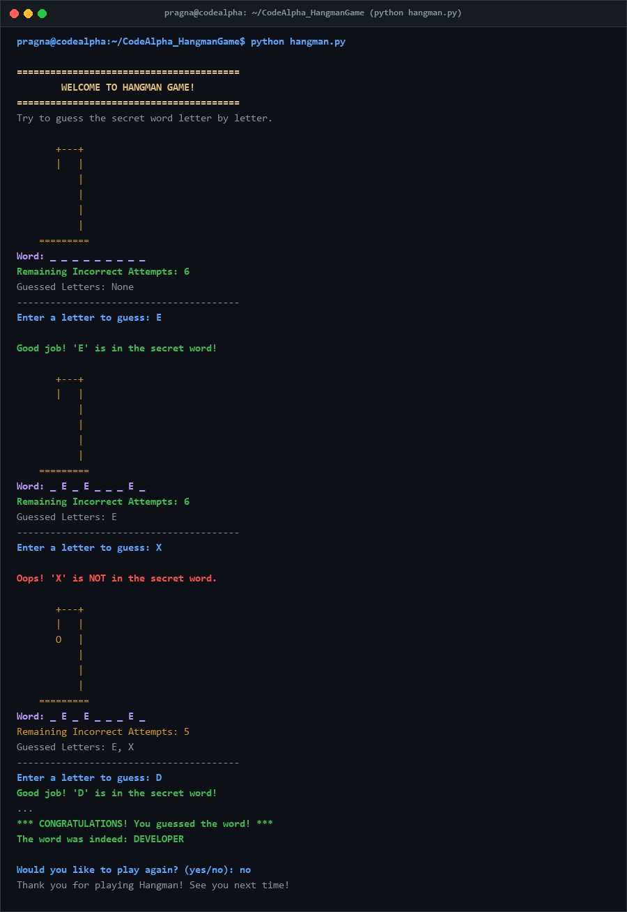

# CodeAlpha Python Programming Internship - Task 1: Hangman Game

<div align="center">


</div>

## 📝 Project Overview
This repository contains a clean, robust, and interactive console-based **Hangman Game** developed in Python for the **CodeAlpha Python Programming Internship (Task 1)**. The game selects a secret word from a predefined pool of 5 words, handles letter-by-letter guessing with input validations, visualizes ASCII hangman gallows progression across 6 allowed incorrect attempts, and provides instant win/loss feedback with replay support.

---

## 🎯 Task Objectives & Compliance
- [x] **Predefined Word List**: Uses a pool of predefined words (`"PYTHON"`, `"DEVELOPER"`, `"CODEALPHA"`, `"INTERNSHIP"`, `"PROGRAMMING"`).
- [x] **Attempt Limiting**: Strictly limits incorrect guesses to **6** with visual ASCII stage tracking.
- [x] **Console I/O**: Clean, formatted command-line interface with no external audio or GUI dependencies.
- [x] **Key Concepts Implemented**: `random`, `while` loops, `if-else` conditionals, string manipulation, set collections, and lists.

---

## 📸 Execution Preview
Below is the verified running screenshot of the Hangman Game in terminal:

<div align="center">



</div>

---

## ✨ Features
- **Smart Game Engine**: Uses Python's `random.choice` to pick words dynamically.
- **7-Stage ASCII Gallows**: Step-by-step visual feedback for every incorrect guess (0 to 6 attempts).
- **Comprehensive Input Validation**:
  - Checks for exact 1-character alphabetical input.
  - Rejects numbers, special symbols, and multi-character strings.
  - Detects duplicate guesses and alerts the user without penalizing attempts.
- **Real-Time Game Dashboard**: Displays revealed letters masked with underscores, remaining attempts, and list of guessed characters.
- **Graceful Termination**: Handles `Ctrl+C` / `EOF` cleanly without unhandled stack traces.
- **Replay Loop**: Lets players start a new game round immediately.

---

## 🛠️ Technologies Used
- **Language**: Python 3.x
- **Core Standard Library**: `random`, `sys`
- **Dependencies**: None (100% built-in standard library)

---

## 📂 Repository Structure
```text
CodeAlpha_HangmanGame/
│
├── hangman.py              # Main Python Game Executable
├── README.md               # Project Documentation & Guide
├── .gitignore              # Git Ignore File
└── screenshots/
    └── run_preview.png     # Terminal Running Screenshot
```

---

## 🚀 How to Run Locally

### Prerequisites
- Python 3.8 or higher installed on your computer.
- Check Python installation:
  ```bash
  python --version
  ```

### Step-by-Step Execution
1. **Clone the repository:**
   ```bash
   git clone https://github.com/pragna3101/CodeAlpha_HangmanGame.git
   ```
2. **Navigate into the directory:**
   ```bash
   cd CodeAlpha_HangmanGame
   ```
3. **Run the game:**
   ```bash
   python hangman.py
   ```
4. **Gameplay:**
   - Type a single letter (e.g., `A`, `E`, `P`) and press **Enter**.
   - Guess all letters before the 6 incorrect attempts run out to win!

---

## 👤 Author
- **Pragna Zala**
- **GitHub**: [@pragna3101](https://github.com/pragna3101)
- **Internship**: CodeAlpha Python Programming Intern
